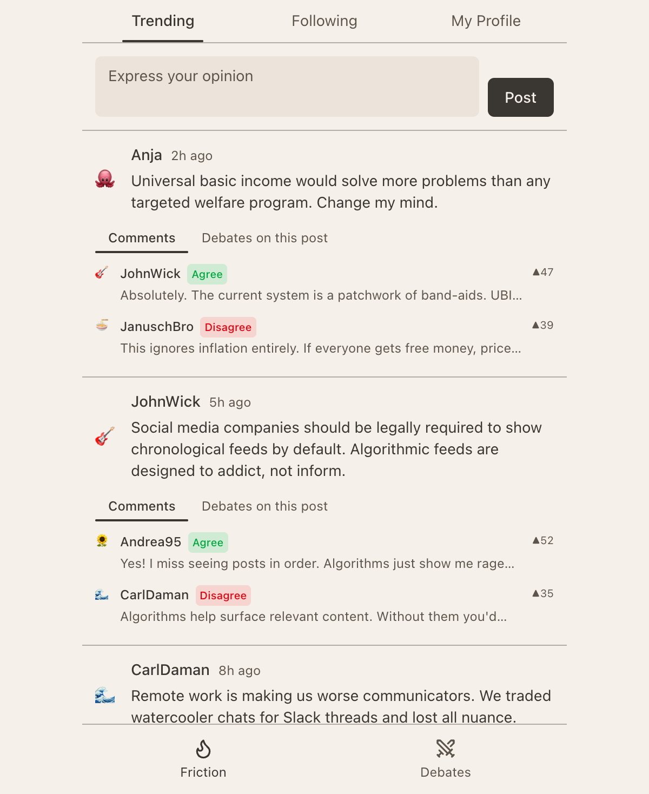
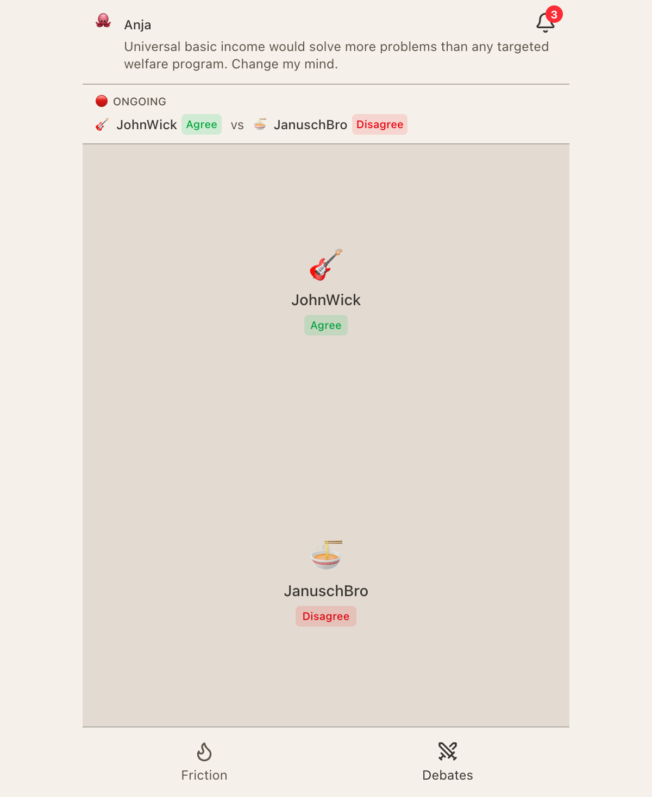

# Friction

Expose disagreement

## Inspiration

Someone told me about friction-maxxing: the belief that modern platforms reduce friction by constantly matching us with what we already think and like. This reduced-friction dynamic feels good, but it can also narrow perspective and weaken idea quality over time.

That inspired a question: what if we designed a platform where you are matched to friction, a platform nudging you towards bursting your filter bubble?

## Problem

Most social platforms optimize for comfort and similarity. They feed us familiar opinions, familiar communities, and familiar arguments.

But friction is not always negative. When it is structured and civil, friction can produce better ideas, stronger arguments, and broader understanding.

## Solution

Friction is a platform for civil discourse built around constructive disagreement.

Users have public profiles (not anonymous), and can:

- post statements
- upvote and downvote
- comment as either "Agree" or "Disagree"

From there, Friction identifies strong opposing viewpoints and invites those users into live debates.

## Debate Matching Model

For each statement:

- users vote and leave Agree/Disagree comments
- top-voted Agree and top-voted Disagree voices get debate invites
- if someone declines, the next strongest matched voice is invited

When users open the Debate section, they see incoming invites/notifications based on this matching model. During each live debate, viewers see the original statement plus each debater's core argument, so the disagreement is clear and grounded.

## Why this matters

Friction turns disagreement into a format that:

- is structured and easy to follow
- exposes friction

## Product Directions

1. **Standalone platform (main direction):** Debate is the main interface, while threads act as a side view that supports debate creation and context. Users discover debates first, then dive into thread discussion for nuance.
2. **Debate-first mode:** Livestream debates are the primary feed, and thread activity is tightly connected to each debate room. New debates are continuously generated from statement + Agree/Disagree engagement.
3. **Reddit add-on / Reddit-based approach:** Friction can layer on top of real Reddit threads by analyzing opposing top comments and inviting matched users into live debates. This allows Friction to bootstrap from existing communities and existing discussion momentum.

## Closing

We do not need less disagreement. We need better disagreement.

Friction is an experiment in making that possible at scale.

